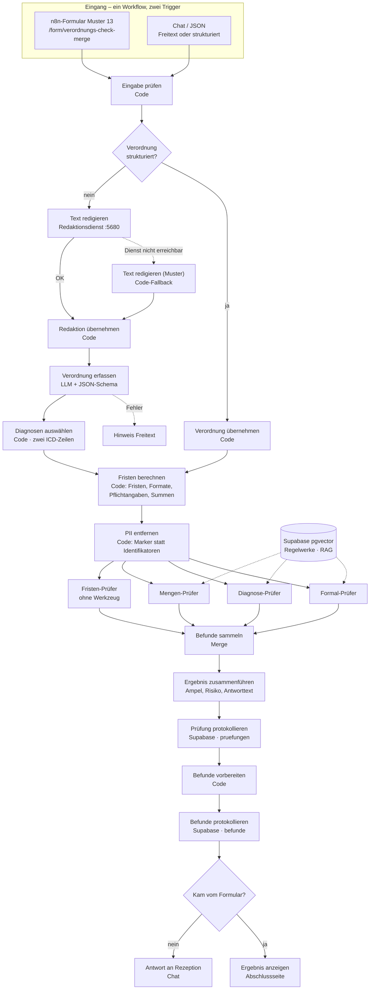

# Verordnungs-Check

KI-gestützte Prüfung ärztlicher Heilmittelverordnungen für eine Physiotherapie-Praxis – bevor behandelt wird, nicht erst bei der Abrechnung.

Capstone-Projekt im Programm *AI Automations & Agents Engineer* (MSIT) und Grundlage der Abschlussprüfung *KI-Tool-Experte/Expertin (IHK)*.

> **Hinweis:** Das Praxisbeispiel ist anonymisiert. Der Prototyp arbeitet ausschließlich mit **synthetischen Verordnungen**. Es werden keine echten Patientendaten verarbeitet.

## Problem

Formfehler auf Heilmittelverordnungen fallen oft erst bei der Abrechnung auf. Dann setzt die Krankenkasse ab: Die Leistung ist erbracht, das Geld fehlt. Die Rezeption hat im Alltag keine Zeit, jede Verordnung gegen Heilmittel-Richtlinie, Heilmittelkatalog und Diagnoseliste zu prüfen.

## Lösung

Die Rezeption erfasst die Verordnung – im n8n-Formular (Muster 13) oder als Chat/JSON. Vier spezialisierte Prüf-Agenten prüfen danach ihr jeweiliges Mandat und belegen ihre Befunde mit Fundstellen aus den Regelwerken (RAG). Das Ergebnis ist eine Ampel mit konkreten Korrekturhinweisen und einem geschätzten Absetzungsrisiko. Jede Prüfung wird protokolliert.

| Prüfer | Mandat | Wissensquelle |
|---|---|---|
| Formal-Prüfer | Pflichtangaben vollständig und formal korrekt | Heilmittel-Richtlinie |
| Diagnose-Prüfer | ICD-10-Code passt zur Diagnosegruppe, Leitsymptomatik, besonderer Verordnungsbedarf | Heilmittelkatalog, KBV-Diagnoseliste |
| Mengen-Prüfer | Höchstmenge je Verordnung, Heilmittel-Kombination, Frequenz | Heilmittelkatalog, Heilmittel-Richtlinie |
| Fristen-Prüfer | Behandlungsbeginn, Unterbrechung | Heilmittel-Richtlinie; Tage rechnet der Code |

Die Rezeption entscheidet. Das System gibt Empfehlungen, es weist nichts automatisch ab.

## Die 18 Prüfkriterien

Die vier Prüfer liefern zusammen 18 Prüfpunkte: 10 zu den Pflichtangaben, 3 zur Diagnose, 3 zu den Mengen und 2 zu den Fristen. Jedes Kriterium hat mindestens einen Testfall in `supabase/seed/testfaelle.sql`; die Zuordnung und die Entscheidungsgrundlage je Kriterium stehen in [`docs/pruefkriterien.md`](docs/pruefkriterien.md).

Was der Code selbst rechnet (Fristen, LANR/BSNR-Format, ICD-Region, Summen der Einheiten, Pflichtangaben), geht als **verbindliche Fakten** an die Prüfer – nur so bleiben Ampel und Befunde reproduzierbar. Das Sprachmodell beurteilt, was im Regelwerk steht, und formuliert die Korrekturhinweise.

## Eingabe

Ein Workflow, zwei Trigger:

1. **n8n-Formular** (Standardweg, Muster 13): in der Cloud `/form/verordnungs-check-cloud` (Workflow `n8n/cloud-verordnungs-check.json`), lokal `/form/verordnungs-check-merge`. Nach dem Absenden prüft der Workflow; die Abschlussseite zeigt Ampel, Tabelle und Prüfpunkte.
2. **Chat / JSON**: Im Chat (Trigger *Rezeption: Verordnung eingeben*) kann strukturiertes JSON aus der Praxissoftware stehen – der Workflow erkennt es (`Eingabe prüfen` → `Verordnung strukturiert?`) und überspringt den LLM-Extraktor. Freitext geht durch Redaktion und Extraktor.
3. **Erfassungsmaske Muster 13** (`formular/`, lokal für die Demo): derselbe Vordruck am Bildschirm, schickt ihr JSON an den Webhook. Unter `formular/vorlagen.html` liegen die 23 Testfälle als Klick-Buttons.

## Architektur



Details: [`docs/architektur.md`](docs/architektur.md)

## Datenschutz: keine Personendaten an die Agenten

Vor den Prüf-Agenten steht der Code-Node **PII entfernen**. Er ersetzt Namen, Geburtsdatum, Versichertennummer, LANR/BSNR sowie Arzt- und Praxisangaben durch Marker wie `[Name]` und entfernt Freitextfelder; das Original bleibt für Protokoll und Antwort erhalten. Im Freitext-Weg redigiert **`Text redigieren`** den Rohtext vorher über einen lokalen Dienst ([`redaktion/`](redaktion/README.md): HuggingFace-NER plus Regeln). Ist der Dienst nicht erreichbar, übernimmt der Knoten **`Text redigieren (Muster)`** mit denselben Regeln im Workflow – es geht also nie Rohtext an ein Modell, nur weniger gründlich redigiert.

Was entfernt wird, was bleibt, wo noch Rohdaten liegen (n8n-Ausführungen, Supabase-Protokoll) und welche Grenzen der Freitext-Weg hat, steht in [`docs/pii-redaktion.md`](docs/pii-redaktion.md).

## Technik

- **n8n** – Orchestrierung, Chat, Formular, vier AI-Agenten; läuft in der Cloud-Instanz des Teams, lokal auch als npm-Paket oder Docker
- **OpenAI** – `gpt-4.1-mini` für die Agenten (Temperatur 0,1), `text-embedding-3-small` für die Vektorsuche
- **Supabase** – PostgreSQL mit pgvector für die Wissensbasis und das Prüfprotokoll (EU-Region Frankfurt)
- **Lokaler Redaktionsdienst** (optional) – Python/FastAPI mit `Davlan/bert-base-multilingual-cased-ner-hrl`, im Image eingebacken und offline lauffähig

## Wissensquellen (frei zugänglich)

- Heilmittel-Richtlinie des G-BA, Fassung in Kraft seit 05.08.2025
- Heilmittelkatalog des G-BA (Zweiter Teil der Heilmittel-Richtlinie)
- Heilmittel-Diagnoseliste der KBV, Stand 01.01.2026
- ICD-10-GM 2026 (BfArM) – bewusst nicht vollständig im Repository, siehe Nutzungsbedingungen des BfArM

## Repository

| Ordner | Inhalt |
|---|---|
| `n8n/` | Workflow-Export `merge-formular-vier-pruefer.json` (Chat + Formular) und `wissensbasis-laden.json` |
| `formular/` | Erfassungsmaske Muster 13, Vorlagen-Seite mit den Testfällen, kein Build |
| `redaktion/` | Redaktionsdienst für den Freitext-Weg (NER + Regeln), Port 5680 |
| `scripts/` | Import vorbereiten, statischer Server der Maske, Testfall-Prüfung, Kriterienliste |
| `supabase/migrations/` | Datenbankschema (001 Init, 002 Diagnoseauswahl) |
| `supabase/seed/` | 23 Testverordnungen, je eine pro Prüfkriterium (Kontrollfälle inklusive) |
| `tests/` | Automatische Tests (`npm test`) und die Testbatterie mit 100 Fällen, siehe [`tests/README.md`](tests/README.md) |
| `docs/` | Design-Briefing, Architektur, Dateneingang, PII, Prüfkriterien, Evaluation, Governance, Ist-Interview |
| `docs/projektarbeit/` | Schriftliche IHK-Projektarbeit, ein Dokument je Kapitel |
| `docs/praesentation/`, `docs/status/`, `docs/field-study/` | IHK-Deck, Statusmeldungen, Interviewunterlagen |

## Lokal starten

```bash
npm install                     # n8n als devDependency, für die Skripte
npm run n8n:vorbereiten         # Import-Datei erzeugen (webhookIds, Workflow-ID)
npx n8n import:workflow --input=.n8n/tmp/verordnungs-check-lokal.json
npx n8n publish:workflow --id=<workflow-id>   # aktivieren (ältere Versionen: update:workflow --active=true)
npm run n8n                     # Oberfläche auf http://127.0.0.1:5678
npm run formular                # Erfassungsmaske + Vorlagen auf http://127.0.0.1:4321
npm run test                    # Code-Tests (Fakten, Diagnoseauswahl, PII, Formular)
npm run test:redaktion          # Regeln des Redaktionsdienstes (Python)
npm run vorlagen:pruefen        # alle Testfälle gegen den laufenden Workflow
```

### Ports

| Port | Dienst | Start | Läuft |
|---|---|---|---|
| **5678** | n8n (Editor, Chat, Formular) | `npm run n8n` oder Docker | bis Prozess/Container endet |
| **5680** | Redaktionsdienst (PII, nur Freitext-Weg) | `npm run redaktion:starten` (Docker) oder `npm run redaktion:lokal` (Python) | Container mit `--restart unless-stopped` |
| **4321** | Dateiserver für `formular/` | `npm run formular` | nur solange der Befehl läuft |

Der Server auf 4321 ist ein einfacher Node-Prozess (`scripts/formular-server.mjs`), der `formular/` ausliefert: `…/muster13.html` und `…/vorlagen`. Er ist nötig, weil die Seiten die Verordnung per `fetch` an n8n schicken – aus `file://` blockieren das viele Browser. Anderer Port: `FORMULAR_PORT=4400 npm run formular`.

## Cloud-Instanz (Team-Setup)

In der Cloud läuft n8n als gehostete Instanz; es gibt dort kein `host.docker.internal`.

1. **Import:** `n8n/cloud-verordnungs-check.json` über die Oberfläche importieren (Workflows → Import from File). Das ist Valentins Architektur mit Redaktion als Regel-Code (`redaktion/cloud/regeln.js`) statt NER-Dienst und mit Code-Urteilen für Leitsymptomatik, Höchstmenge, Kombination und Frequenz. Für Scans und Fotos gibt es die Variante `n8n/verordnungsbackup-scan.json` (Vision, Stand vor den Code-Urteilen).
2. **Credentials** anlegen – die Knoten verweisen auf diese Namen:
   | Credential | Typ | Inhalt |
   |---|---|---|
   | `OpenAI account` | OpenAI | API-Key von platform.openai.com |
   | `Supabase Verordnungs_check` | Supabase | Host-URL und service_role-Key des Projekts |
3. **Wissensbasis laden** einmal ausführen (`n8n/wissensbasis-laden.json`) – füllt `documents` mit rund 380 Abschnitten, eingebettet mit `text-embedding-3-small`. Nach einem Wechsel des Embedding-Modells muss sie neu geladen werden, sonst passen die Vektoren nicht mehr zusammen.
4. **Formular-Adresse** notieren: `/form/verordnungs-check-cloud` (Pfad im Form-Trigger änderbar). Die Chat-Adresse vergibt n8n beim Import neu (`/webhook/<id>/chat`).
5. **Testbatterie** (optional): Datenbrücke `n8n/sdk/testbatterie-datenbruecke.mjs` anlegen, Token selbst setzen, dann `tests/cloud/batterie.py` – siehe [`tests/cloud/README.md`](tests/cloud/README.md).

Der lokale Merge-Workflow (`n8n/merge-formular-vier-pruefer.json`) mit NER-Redaktionsdienst (`redaktion/`, `REDAKTION_URL`) bleibt als Referenz erhalten.

Die Erfassungsmaske und die Vorlagen-Seite lassen sich lokal gegen die Cloud nutzen: `muster13.html?webhook=https://<instanz>/webhook/verordnungs-check/chat`.

## Tests und Evaluation

- **23 Seed-Fälle** (`supabase/seed/testfaelle.sql`): je ein Fall pro Prüfkriterium, dazu grüne Kontrollfälle. `npm run vorlagen:pruefen` prüft Ampel **und** die erwarteten Befunde und gibt am Ende die Abdeckung der 18 Kriterien aus. Gegen die Cloud-Instanz: `npm run vorlagen:pruefen -- --url https://<instanz>/webhook/<id>/chat`.
- **Testbatterie** (`tests/testbatterie.json`, 100 Fälle in Entwicklungs- und Evaluationsset): Vorgehen in [`tests/README.md`](tests/README.md).
- **Testbatterie gegen die Cloud** (`tests/cloud/`, 27.10.2026): 123 Fälle aus Supabase, E-Set dreifach. Ergebnisse als JSONL in `tests/cloud/ergebnisse/`.
- **Automatische Tests** (`npm test`): Fakten-Code, Diagnoseauswahl, PII-Redaktion, Erfassungsmaske, Cloud-Export – alle lesen den Workflow-Export und schlagen fehl, wenn Code und Doku auseinanderlaufen.

## Team

| Name | Rolle |
|---|---|
| Thomas Kullmann | Koordination, Ist/Soll-Analyse & Business Case |
| Valentin Klamka | Tools, Architektur & Governance |
| Derk Ermler | Build, Demo & Evaluation |

Seit 19.10.2026 arbeitet das Team zu dritt.

## Status

Stand 27.10.2026 – Cloud-Workflow läuft, Bewertung **bedingt bereit**:

- Wissensbasis geladen (HeilM-RL, Heilmittelkatalog, KBV-Diagnoseliste, rund 380 Abschnitte in Supabase)
- Testbatterie Evaluationsset (59 Fälle × 3 Läufe, ohne v5-Fälle): Ampel korrekt 83,1 % im Blindlauf, 94,9 % nach den Code-Regeln, 96,6 % im Nachtest; keine übersehene rote Verordnung mehr, ein kritischer Fehlalarm
- Laufzeit Median rund 34 s je Prüfung, Kosten rund 3 Cent
- Der zweite Lauf ist kein Blindtest mehr: Die Regeln wurden nach dem ersten Lauf ergänzt

Offen: KBV-Hinweis-Fälle (gelb), Freitext-Extraktion der Diagnosegruppe, Laufzeit, Prüfung des Verordnungsfalls (v5). Soll-Werte TF10 (rot) und TF108 (gelb) am 27.10. im Team bestätigt (siehe [`docs/aenderungsprotokoll.md`](docs/aenderungsprotokoll.md)).

## Dokumentation

Design-Briefing: [Scope](docs/scope.md) · [Erfolgskriterien](docs/erfolgskriterien.md) · [Implementierungsweg](docs/implementierung.md) · [Architektur](docs/architektur.md) · [Build-Plan](docs/build-plan.md) · [Dateneingang](docs/dateneingang.md)

Fachlich und Betrieb: [Prüfkriterien](docs/pruefkriterien.md) · [PII-Redaktion](docs/pii-redaktion.md) · [Vordruck Muster 13](docs/vordruck-muster13.md) · [Evaluation](docs/evaluation.md) · [Governance](docs/governance.md) · [Änderungsprotokoll](docs/aenderungsprotokoll.md) · [Ist-Interview](docs/ist-interview.md)

IHK: [Projektarbeit](docs/projektarbeit/README.md) · [Präsentation 3 × 15 min, Entwurf 27.10.](docs/praesentation/Verordnungs-Check_IHK_3x15min_2026-10-27_Entwurf.pdf) · [Statusmeldung MSIT](docs/status/Verordnungs-Check_Status_MSIT_2026-10-19.pdf)
